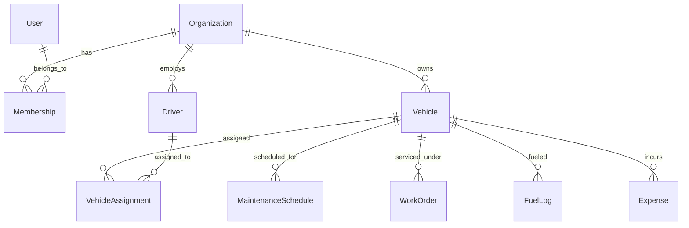

# FleetOps Cloud — Data Model Documentation

## 1. Tenancy Model
FleetOps Cloud is structured around a strict multi-tenant boundary:
* **`Organization`**: The tenant root. Every fleet asset, driver, assignment, maintenance log, expense, and document belongs to exactly one organization.
* **`Membership`**: Relates a `User` to an `Organization` with a specified `Role` (*Owner, Admin, Fleet Manager, Driver, Viewer*). A single user can belong to multiple organizations (with separate roles in each).

## 2. Model Hierarchy

## 3. Core Models Summary

### `accounts.User`
- Subclasses Django's `AbstractBaseUser` and `PermissionsMixin`.
- Primary identity via unique `email` (case-insensitive normalized).
- Fields: `email`, `first_name`, `last_name`, `phone_number`, `is_active`, `is_staff`, `date_joined`.

### `organizations.Organization`
- Fields: `name`, `slug` (unique), `contact_email`, `phone_number`, `created_at`, `updated_at`, `is_active`.

### `organizations.Membership`
- Unique constraint: `(user, organization)`
- Fields: `user`, `organization`, `role` (*OWNER, ADMIN, FLEET_MANAGER, DRIVER, VIEWER*), `joined_at`.

### Base Model: `TenantModel` (`apps.core.models`)
- Abstract base model inherited by all tenant-scoped entities.
- Fields: `organization` (ForeignKey, `on_delete=models.CASCADE`), `created_at`, `updated_at`.
- Custom Manager: `TenantManager` with helper `.for_organization(org)`.
